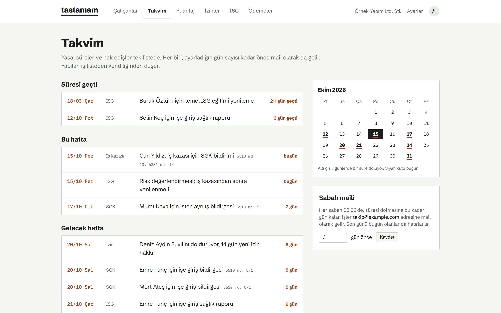
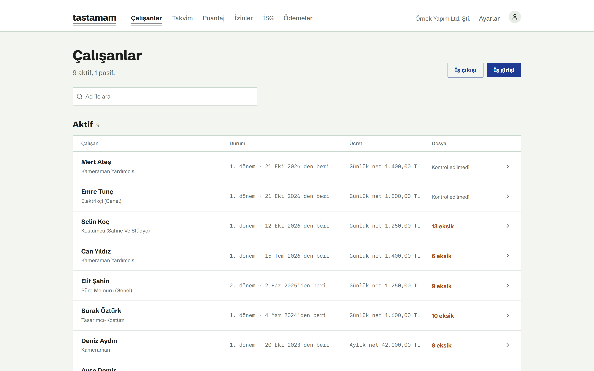
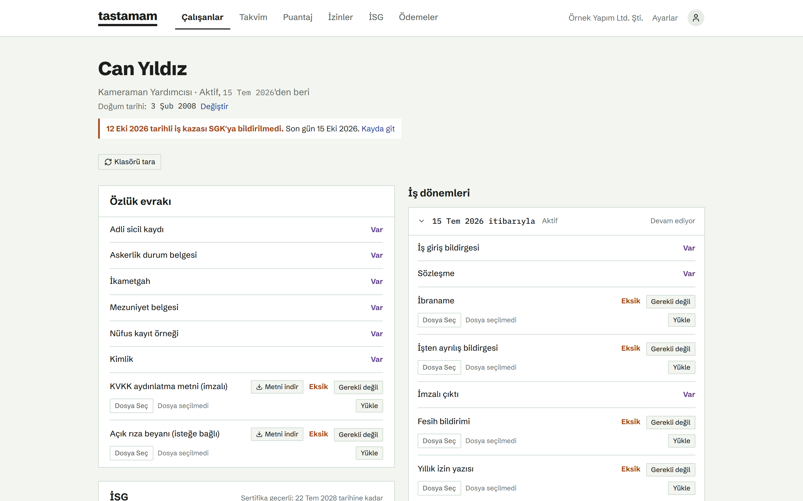
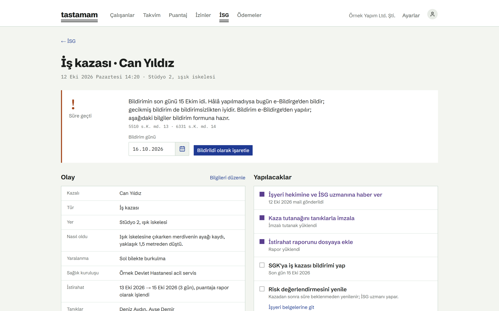
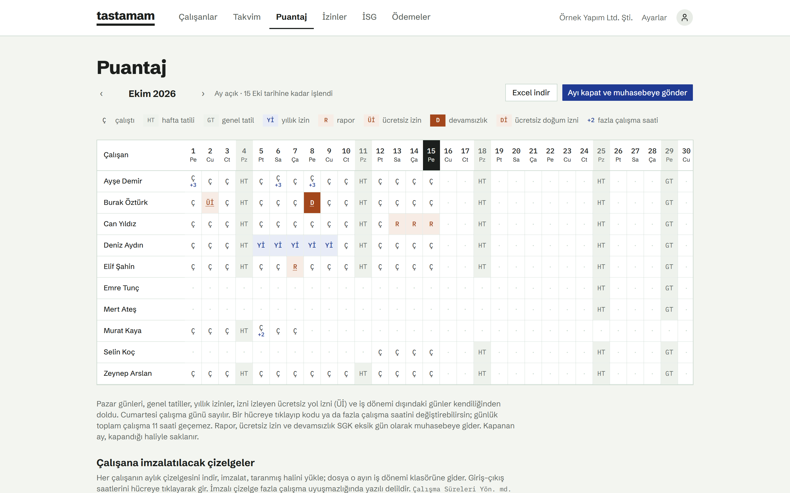
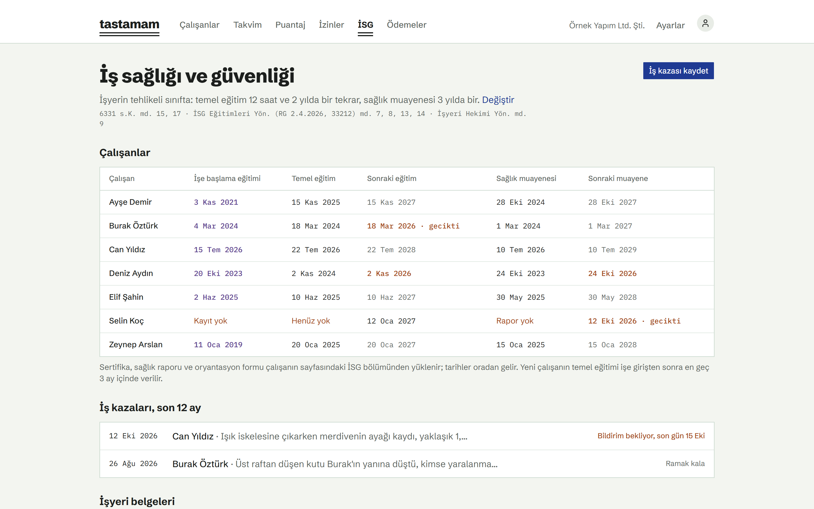
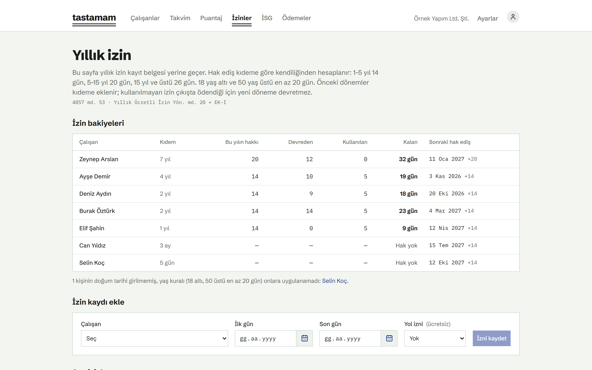
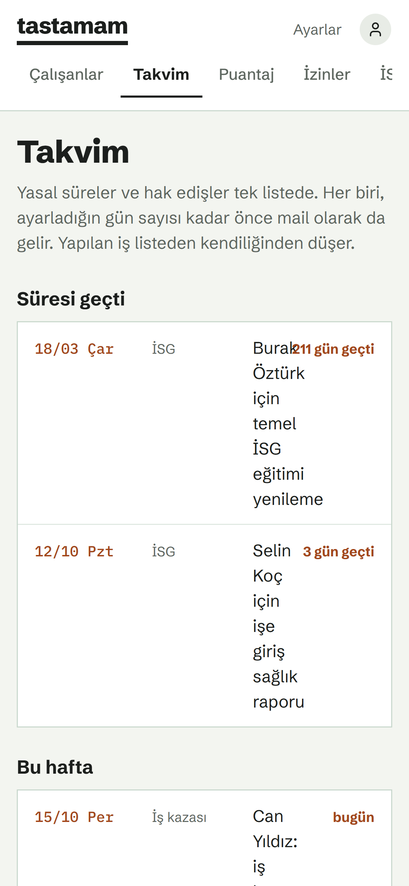
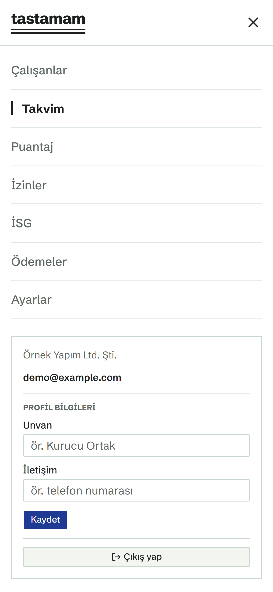

# tastamam

**İşverenin kayıt defteri. Eksiksiz, zamanında.**
*The employer's record book for Turkish companies. Always complete, never late.*

[Türkçe](#türkçe) · [English](#english)



---

## Türkçe

Tastamam, Türkiye'deki küçük ve orta büyüklükteki şirketler için açık kaynak bir işveren
kayıt defteri. Kanunun tutmanı istediği çalışan kayıtlarını tutar, yasal süreleri
kaçırtmaz. Denetim geldiğinde dosyan hazır olur.

Tastamam senin bilgisayarında çalışır. Kayıtların ve belgelerin senin bilgisayarında ya da
senin açtığın hesaplarda (ör. kendi Supabase projen) durur; bize ya da başka birine hiçbir
veri gönderilmez. Bir hizmet değil, indirip kendi başına kullandığın bir uygulamadır.

İK yazılımı değildir: işe alım, performans ya da bordro hesabı yapmaz. Bordroyu mali
müşavirin hazırlamaya devam eder; Tastamam ona gidecek bildirimi zamanında hazırlar.

### Ne yapar

- **Ana sayfa:** genel durum tek bakışta: aktif çalışanlar, eksik evrak, yaklaşan yasal
  süreler, doğum günleri ve son hareketler.
- **Çalışan dosyası:** her çalışan için gereken özlük evrakı ve iş dönemi belgeleri tek
  listede. Eksik olan görünür, yüklenen belge standart adla doğru klasöre gider. Doğum
  tarihi SGK bildirgesinden ya da nüfus kayıt örneğinden kendiliğinden okunur.
- **İş girişi ve çıkışı:** SGK bildirgesi için muhasebeye mail tek tıkla (toplu giriş ve
  çıkış dahil). Muhasebeden dönen belge gelen kutusundan okunup doğru kişinin klasörüne
  dosyalanır.
- **İş sözleşmesi ve KVKK:** iş sözleşmesi şablondan, çalışanın bilgileriyle hazırlanır;
  örnek şablon yüklü gelir, istersen şirketinin kendi şablonunu yükleyebilirsin. KVKK
  aydınlatma metni her çalışan için hazırlanır, imzalı nüshası dosyasında takip edilir;
  görüntü ve ses kullanımı gibi işlemler için ayrı, isteğe bağlı açık rıza beyanı.
- **Puantaj:** aylık çalışma çizelgesi; hafta tatili, genel tatil, yıllık izin ve rapor
  günleri kendiliğinden dolar. SGK eksik gün kodu önerisi, fazla çalışma takibi (270 saat
  uyarısı), muhasebeye Excel, çalışana imzalatılacak tek sayfalık çizelge. Birden çok
  günü seçip tek seferde işaretleyebilir, bir çalışanın ayarlarını diğerlerine
  uygulayabilirsin.
- **Yıllık izin:** kıdeme ve yaşa göre hak ediş, izin kayıt belgesi, imzalı izin formu,
  çıkışta ödenecek izin.
- **İSG:** işyerinin tehlike sınıfına göre eğitim ve sağlık muayenesi yenileme tarihleri,
  risk değerlendirmesi ve acil durum planı takibi.
- **İş kazası:** olay kaydı, SGK'ya 3 iş günü bildirim süresinin geri sayımı, tutanak ve
  rapor, istirahatin puantaja işlenmesi.
- **Fazla çalışma ve çıkış belgeleri:** fazla çalışma yapılan dönemde onay belgesi, onayın
  geri alınması ve yasak durumlarda puantaj uyarısı; çıkışta çalışma belgesi; aylık imzalı
  ücret pusulası arşivi.
- **Duruma bağlı kayıtlar:** gebelik, doğum ve süt izni, gece çalışma raporu, yabancı
  çalışanın çalışma izni, çalışma koşulu değişikliği, savunma tutanağı; BES katılım ve
  cayma; engelli kontenjanı uyarısı.
- **Zimmet:** teslim edilen eşyalar, iade takibi ve zimmet tutanağı.
- **Takvim:** bütün yasal süreler tek listede; istersen yaklaşınca sabah maili. İşten ayrılanların
  kişisel verilerinin saklama süresi dolunca hatırlatır.
- **Belgeler nerede dursun:** bu bilgisayardaki bir klasör (OneDrive/Dropbox eşitleme
  klasörü olabilir), Supabase Storage, OneDrive ya da Google Drive.

Geliştiriliyor: muhasebeden gelen ücret pusulalarının mailden otomatik dosyalanması.

<table>
<tr><td></td><td></td></tr>
<tr><td></td><td></td></tr>
<tr><td></td><td></td></tr>
</table>

### Telefondan

Tastamam'ı kendi domain'in üzerinden yayınlarsan telefondan da kullanabilirsin; ekranlar
telefona göre düzenlenir, bütün sayfalar sağ üstteki menüde. Nasıl yapılacağı
[KURULUM.md](KURULUM.md) içinde.

<table>
<tr><td width="50%"></td><td width="50%"></td></tr>
</table>

Ekranlardaki kişiler ve şirket kurgudur (`supabase/seed.sql`).

Kurallar ve süreler resmi metinlerden okunup dayanağıyla birlikte
[`src/lib/mevzuat.ts`](src/lib/mevzuat.ts) içinde tutulur; testleri `npm run test:mevzuat`.

### Kurulum

Tastamam senin bilgisayarında çalışır; tarayıcıdan `http://localhost:3000` ile kullanırsın.
Telefondan kullanmak için kendi domain'ine bağlanabilir.

En kolayı: repoyu indir, bilgisayarındaki yapay zekâ ajanına (Claude Code, Codex, Cursor…)
klasörü aç ve **"KURULUM.md'yi oku ve Tastamam'ı kur"** de. Elle kurmak için adımlar
[KURULUM.md](KURULUM.md) içinde.

Gerekenler: Node.js 20+, ücretsiz bir Supabase hesabı (ya da Docker ile tamamen yerel
veritabanı), bir şirket mail kutusu (SMTP).

### Önemli

Tastamam hukuki danışmanlık değildir. Süreleri ve kuralları mali müşavirinle teyit et.
Mevzuat değişebilir; bir hata görürsen issue aç.

---

## English

Tastamam is an open-source employee record book for small and medium-sized companies in
Turkey. It keeps the employee records that Turkish labour and social-security law requires
and makes sure no legal deadline is missed. It is not an HR suite: no recruiting,
performance reviews or payroll calculation.

Tastamam runs on your own computer. Your records and documents stay on your machine or in
accounts you own (e.g. your own Supabase project); no data is ever sent to us or anyone else.
It is not a hosted service but an application you download and run yourself.

**Features:** a home page with the overall status (active employees, missing documents,
upcoming deadlines, birthdays, recent activity); employee files with required-document
checklists, with dates of birth read from SGK notices or civil registry records; hiring and termination
notices e-mailed to the accountant, with replies filed automatically; employment contracts
from a template (a sample is included, or upload your own); KVKK privacy notices per
employee with optional separate consent forms; monthly timesheets with SGK missing-day codes, overtime limits and multi-day bulk editing; annual leave
entitlement and leave records; occupational health and safety renewals by hazard class;
work accident records with the 3-business-day SGK notification countdown; overtime consent
and prohibition warnings, employment certificates and signed payslip archive; special
statuses (pregnancy, maternity and nursing leave, night-work health reports, work permits,
changes to working conditions) and equipment hand-over records; a single deadline
calendar with an optional morning reminder e-mail. Documents can live in a local folder,
Supabase Storage, OneDrive or Google Drive.

**On your phone:** if you publish Tastamam on your own domain, you can use it from your
phone as well; the screens adapt to mobile and every page is in the menu at the top right
(see the screenshots above and [KURULUM.md](KURULUM.md)).

The interface and documentation are in Turkish, since the rules are Turkish law.

**Install:** Tastamam runs on your own computer and is used from the browser. Download the
repository, open it with your coding agent and ask it to follow [KURULUM.md](KURULUM.md),
or follow the steps yourself. Requires Node.js 20+, a free Supabase project (or local
Supabase via Docker) and an SMTP mailbox.

**Disclaimer:** not legal advice. Verify deadlines and rules with your accountant.

---

## Teknik / Technical

Next.js (App Router, TypeScript) · Tailwind · Supabase (Postgres, Auth, Storage) ·
Schibsted Grotesk + IBM Plex Mono (OFL).

```bash
npm install
npm run kur -- --admin ad@sirketin.com   # .env.local kontrolü, migration'lar, ilk kullanıcı
npm run dev                              # geliştirme
npm run test:mevzuat                     # kural testleri
```

Katkı: [CONTRIBUTING.md](CONTRIBUTING.md) · Güvenlik: [SECURITY.md](SECURITY.md)

## Geliştiren / Made by

Tastamam, [Sceneva Labs](https://github.com/ScenevaLabs) tarafından geliştirilir.

## Lisans / License

[AGPL-3.0](LICENSE). Tastamam'ı değiştirip başkalarına ağ üzerinden hizmet olarak
sunarsan, değiştirdiğin kaynak kodu da onlarla paylaşman gerekir.
